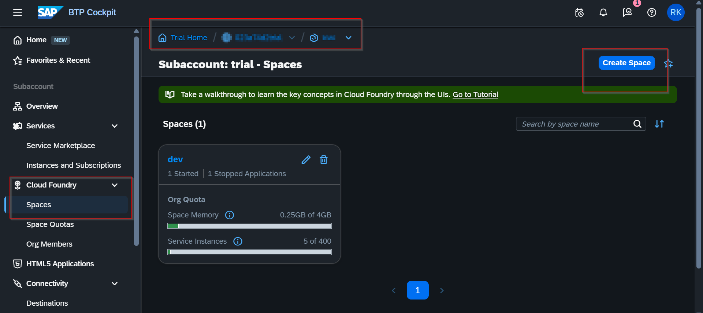
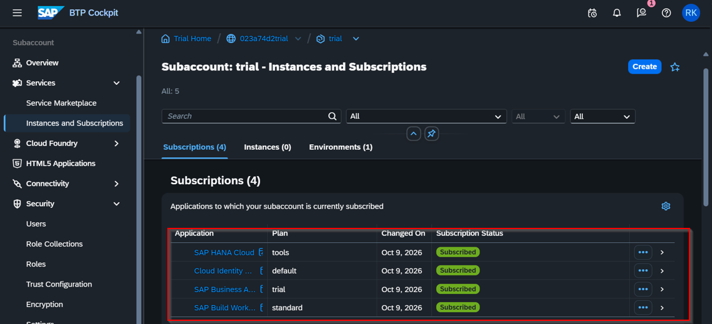
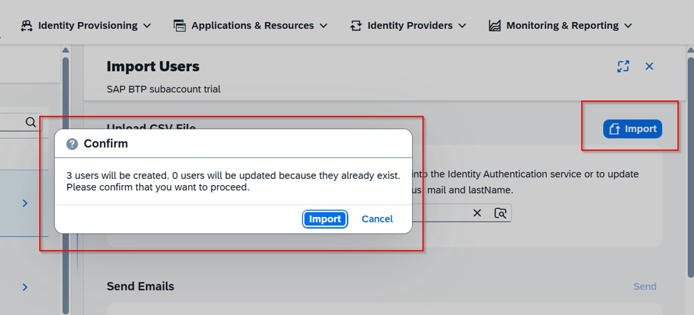
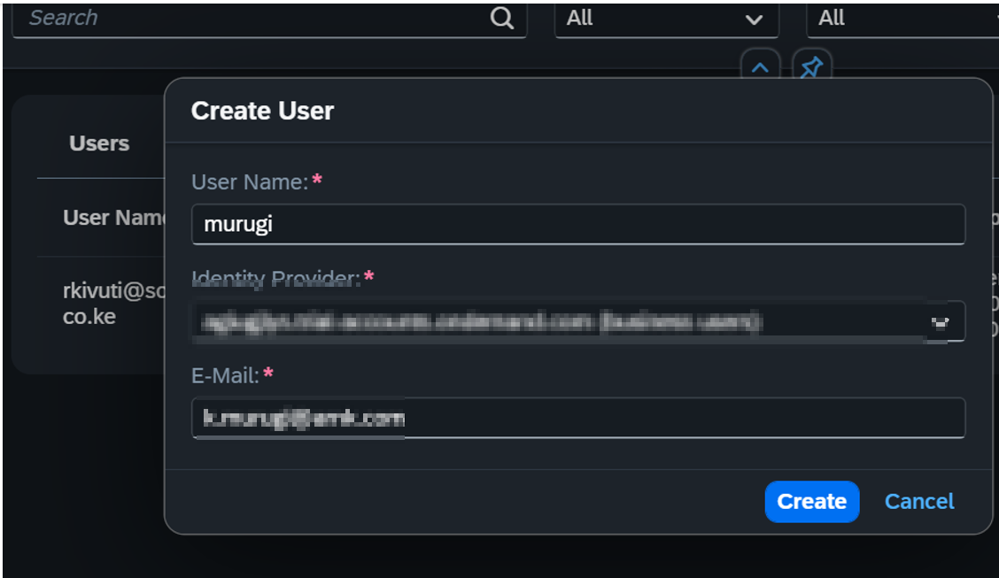
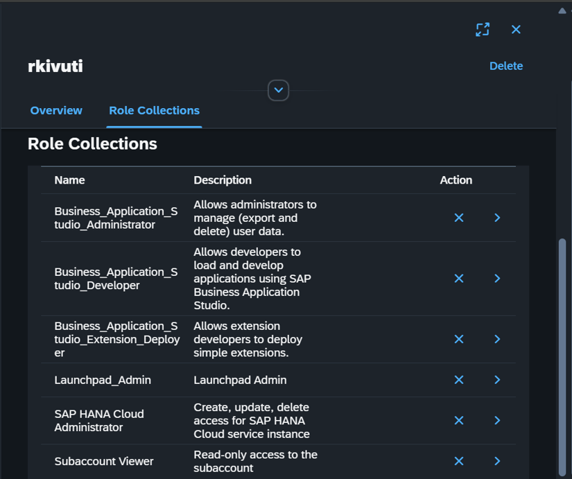

# 1: Environment, Subscriptions and Identity Setup

This document records how I established the foundational architecture on SAP Business Technology Platform (BTP) Trial—setting up my subaccount, subscribing to essential cloud services and configuring Identity & Access Management (IAM) through SAP Cloud Identity Services.

---

## BTP Architecture & Setup Breakdown

Understanding the BTP hierarchy and identity flow.
| BTP Hierarchy Level | Phase / Step | Key Configuration Actions |
| :--- | :--- | :--- |
| **Global Account** *(Root Container)* | **Step 1: Account Registration** | • Provision the root Global Account • Create default Trial Subaccount |
| **Subaccount** *(Runtime Workspace)* | **Step 2: Service Subscriptions** | • Subscribe to **SAP HANA Cloud** • Enable **Cloud Identity Services** • Subscribe to **SAP Build Work Zone** |
| **Subaccount & Identity Provider** *(Security Boundary)* | **Step 3: Identity & Access Management (IAM)** | • Import users into IAS via **SCIM 2.0** • Establish Trust between IAS & Subaccount • Map IAS Users & assign **Role Collections** |

* **Global Account vs. Subaccount:** The **Global Account** represents the root contract or subscription level. The **Subaccount** is the isolated runtime environment where databases, applications and microservices live. Security and resource boundaries are strictly enforced at the subaccount level.
* **Service Subscriptions:** Enabling SaaS components like **SAP Business Application Studio**, **SAP HANA Cloud** and **SAP Build Work Zone** inside the subaccount so they can interact across the runtime landscape.
* **SAP Identity Authentication Service (IAS):** Acts as our central Identity Provider (IdP). Rather than relying on standard BTP trial credentials, enterprise setups delegate user authentication to IAS to centralize single sign-on (SSO) and multi-factor policies.
* **SCIM 2.0 (System for Cross-domain Identity Management):** An open standard protocol used to automate user provisioning. Importing CSV files with standardized SCIM headers allows bulk user onboarding across enterprise applications.
* **Role Collections:** Bundles of individual application permissions (scopes). Assigning role collections to mapped IAS users controls what they can deploy, manage or view inside BTP.

---

## Step 1: Setting Up the BTP Subaccount & Cloud Foundry

1. Registered and logged into the **SAP BTP Trial Cockpit**, which automatically provisioned my root **Global Account** and primary **Subaccount**.
2. Navigated to the subaccount overview and accessed the **Cloud Foundry Environment** configuration.
3. Enabled Cloud Foundry and verified my regional landscape details:
   * **API Endpoint:** Recorded full regional endpoint.
   * **Org Name:** Primary trial organization identifier.
4. Navigated to **Cloud Foundry > Spaces** and created my runtime `dev` space.

---

## Step 2: Enabling Service Subscriptions

Inside the subaccount **Service Marketplace** (and **Instances and Subscriptions**), I subscribed to the core services needed for the runtime stack:

1. **SAP HANA Cloud:** Enabled managed database capabilities.
2. **SAP Business Application Studio:** Provisioning the cloud-native development environment for building and compiling full-stack CAP applications.
3. **Cloud Identity Services:** Linking of my custom IAS tenant for identity provisioning.
4. **SAP Build Work Zone, Standard Edition:** Enabled the application launchpad portal and HTML5 app router runtime.

---

## Step 3: Identity Provisioning and Assigning Role Collections

### 3.1 Importing Users
1. Opened the custom IAS Administration Console under **User Management > Import Users**.
2. Uploaded a CSV file configured with SCIM 2.0 schema attributes.
3. Executed the bulk user import action.

### 3.2 Mapping IAS Users to the BTP Subaccount
1. Returned to the BTP Subaccount Cockpit under **Security > Users**.
2. Mapped user identities from IAS into the BTP subaccount runtime context.

### 3.3 Assigning Administrative Role Collections
1. Selected my mapped custom user in **Security > Users**.
2. Clicked **Assign Role Collection** to grant necessary administrative and developer permissions:
   * `Business_Application_Studio_Administrator`
   * `Business_Application_Studio_Developer`
   * `Launchpad_Admin`
   * `SAP HANA Cloud Administrator`
   * `Subaccount Viewer`
3. Confirmed assignment.

---

## Checkpoint
- [x] Cloud Foundry `dev` space created and running.
- [x] Subscriptions active for SAP HANA Cloud, Business Application Studio, Cloud Identity Services and SAP Build Work Zone.
- [x] Custom users imported into IAS.
- [x] IAS user mapped to BTP subaccount and administrative role collections assigned.
