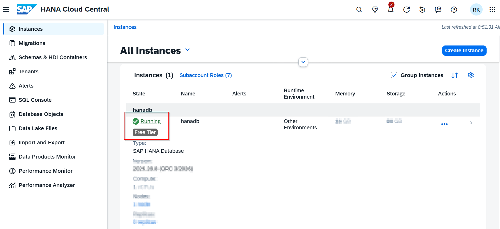
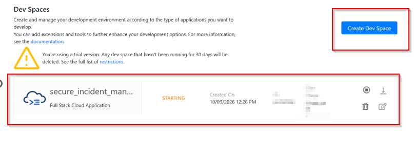
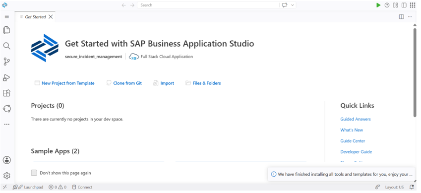

# 2: Provisioning and Development Environment Setup

This document records how I provisioned the persistence layer using **SAP HANA Cloud** and established my cloud development environment inside **SAP Business Application Studio (BAS)** to prepare for building and testing the CAP application.

## BTP Architecture & Setup Breakdown
Understanding the relationship between cloud databases, containerized deployment modules and cloud IDEs.

| BTP Hierarchy Level | Step | Key Configuration Actions |
| :--- | :--- | :--- |
| **Subaccount Service Marketplace** *(Persistence Tier)* | **Step 1: SAP HANA Cloud Provisioning** | • Provision managed SAP HANA Cloud instance • Set strong database administrator password • Configure network access rules for BTP services |
| **Subaccount Subscriptions** *(Development Tier)* | **Step 2: SAP Business Application Studio (BAS)** | • Create Full Stack Cloud Application Dev Space • Initialize cloud workspace for CAP project development |

* **SAP HANA Cloud Instance:** Acting as the primary relational database, SAP HANA Cloud stores core entity tables (such as Incidents, Customers, Customer Addresses) in-memory, delivering high-performance data processing and enterprise security compliance.
* **Database Deployer (`-db-deployer`):** In a CAP project, the database deployer is a dedicated microservice container. During execution, it establishes a secure HDI (HANA Database Interface) connection, executes database design artifacts, provisions tables and views, populates initial seed data and then terminates.
* **SAP Business Application Studio (BAS):** A pre-configured, cloud-native development environment equipped with integrated runtimes (Node.js, CDS CLI, Cloud Foundry CLI and MTA Build Tool) that eliminates local dependency conflicts.

## Step 1: Provisioning the SAP HANA Cloud Database
1. Navigated to my BTP trial subaccount cockpit and accessed **SAP HANA Cloud**.
2. Initiated instance creation with the following configurations:
   * **Instance Name** 
   * **Administrator Password:** Configured robust credentials for the database admin user.
   * **Allowed IP Addresses:** Configured network security to permit access from **BTP Services and Applications** so runtime services and BAS can connect.

## Step 2: Setting Up SAP Business Application Studio (BAS)
1. Returned to the BTP subaccount cockpit and opened **Instances and Subscriptions > SAP Business Application Studio**.
2. Clicked **Create Dev Space** to provision a dedicated development environment.

3. Selected **Full Stack Cloud Application** as the application profile to ensure all prerequisite development toolkits are pre-installed.

## Checkpoint
- [x] SAP HANA Cloud instance provisioned and confirmed running.
- [x] Network security rules configured to allow BTP service connections.
- [x] Full Stack Cloud Application Dev Space created and active inside BAS.
