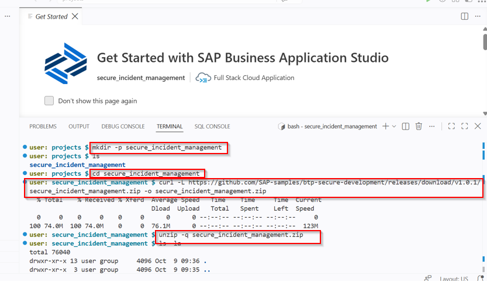

# 3: Application Acquisition, Build and Cloud Foundry Deployment

This document records the exact steps executed inside the SAP Business Application Studio terminal to acquire the CAP project codebase, authenticate against Cloud Foundry, compile the Multi-Target Application (MTA) and deploy the services to SAP BTP.

## BTP Architecture & Setup Breakdown
Understanding packaging formats, enterprise authentication flows and runtime deployment pipelines.

| BTP Hierarchy Level | Step | Key Configuration Actions |
| :--- | :--- | :--- |
| **Cloud Foundry Runtime**<br>*(Application Architecture)* | **Step 1: Project Acquisition** | • Initialize workspace directory<br>• Download CAP sample project release package<br>• Extract project structure |
| **Cloud Foundry CLI**<br>*(Security & Access)* | **Step 2: Authentication** | • Target regional Cloud Foundry API endpoint<br>• Authenticate <br>• Confirm target organization and dev space |
| **MTA Build Tool & Deployer**<br>*(Deployment Pipeline)* | **Step 3: Build & Deploy** | • Install package dependencies via `npm install`<br>• Compile MTA archive (`.mtar`) using `mbt build`<br>• Deploy services and database deployer via `cf deploy` |

* **Multi-Target Application (MTA):** An SAP standard packaging format (`.mtar`) that bundles heterogeneous modules; such as Node.js CAP services, HTML5 UI apps, database deployers and security bindings into a single deployable archive defined by `mta.yaml`.
* **Single Sign-On:** Cloud Foundry authentication delegates login to an Identity Provider (IAS/SAP ID) using a temporary passcode.
* **Target Regional Endpoints:** Explicitly specifying regional endpoints ensures the Cloud Foundry CLI directs API commands to the exact subaccount controller.

## Step 1: Fetching and Extracting the CAP Project
Inside the BAS terminal, I initialized the workspace directory, pulled the project repository release package and unzipped the application source files:

```bash
mkdir -p secure_incident_management
cd secure_incident_management
curl -L [https://github.com/SAP-samples/btp-secure-development/releases/download/v1.0.1/secure_incident_management.zip](https://github.com/SAP-samples/btp-secure-development/releases/download/v1.0.1/secure_incident_management.zip) -o secure_incident_management.zip
unzip -q secure_incident_management.zip
```


## Step 2: Cloud Foundry Authentication
To authenticate the BAS terminal against my BTP subaccount:
1. Executed `cf login --sso` with the regional API endpoint
2. Opened the generated temporary authentication link, retrieved the one-time passcode and submitted it into the terminal console.
3. Target selection confirmed my organization and dev Space.

## Step 3: Building and Deploying the MTA Package
1. Resolving project dependencies and preparing the Node.js runtime environment
```bash
npm install && update
```
2. Compiling multi-module application artifacts into a production-ready Multi-Target Application archive (.mtar)
```bash
mbt build
```
3. Executing deployment of the compiled MTA package to the targeted Cloud Foundry space
```bash
cf deploy mta_archives/incident-management_1.0.0.mtar
```
4. Verified application status within the SAP BTP Cockpit to ensure active running state for the core service and successful execution of the database deployer module.

## Executed
- [x] Downloaded and unarchived the CAP application source code inside SAP Business Application Studio.
- [x] Established authenticated Cloud Foundry session.
- [x] Successfully compiled the Multi-Target Application archive (.mtar) using the SAP MTA Build Tool.
