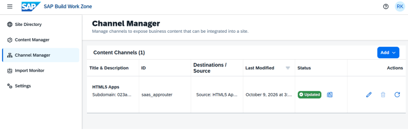
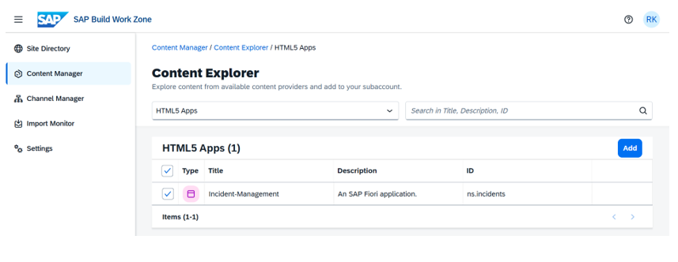
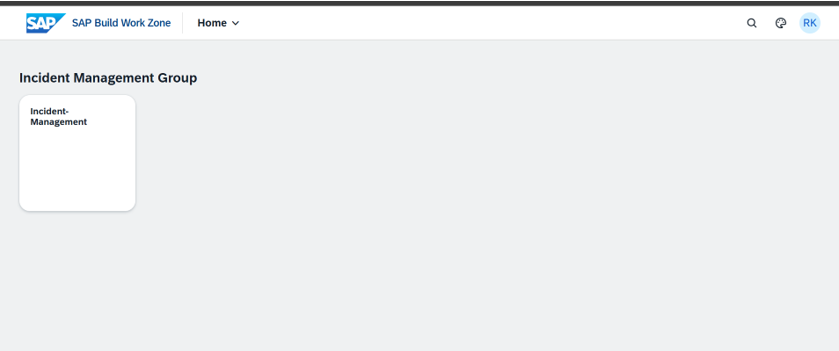
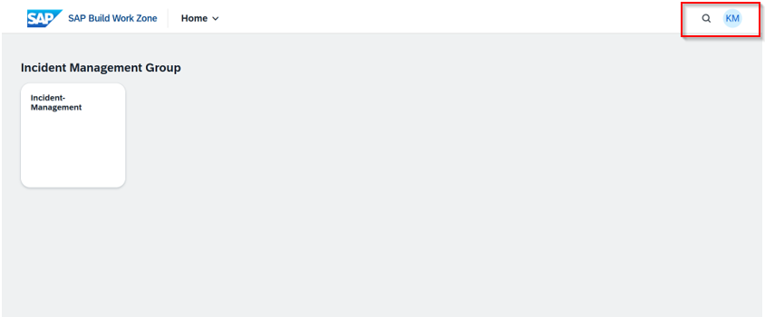

# 4: SAP Build Work Zone Portal & Launchpad Integration

This document records how I integrated the deployed CAP application HTML5 frontend artifacts into **SAP Build Work Zone, Standard Edition**, establishing a centralized enterprise launchpad portal, configuring application routing, and verifying role-based multi-user launchpad access.

## BTP Architecture & Setup Breakdown
Understanding HTML5 application repositories, portal content providers, site management and launchpad navigation.

| BTP Hierarchy Level | Step | Key Configuration Actions |
| :--- | :--- | :--- |
| **Channel Manager** *(Content Providers)* | **Step 1: Content Provider Integration** | • Refresh HTML5 Application Repository content provider (`saas_approuter`)  • Sync deployed HTML5 app router artifacts and metadata |
| **Content Manager** *(Role & App Catalog)* | **Step 2: Catalog & Content Explorer** | • Discover `Incident-Management` UI app in Content Explorer • Add application tile to Content Manager catalog and assign portal roles |
| **Site Directory** *(User Experience)* | **Step 3: Launchpad Site & Access Control** | • Add application tile to Launchpad Site page group • Verify federated single sign-on (SSO) and role access across test users |

* **HTML5 Application Repository:** BTP service that centrally stores static UI artifacts (UI5 app resources) uploaded during MTA deployment, serving them efficiently to the app router runtime.
* **Channel Manager:** The management interface inside SAP Build Work Zone that controls content channels and syncs deployed UI services into the portal.
* **Launchpad Site & Groups:** Organizes individual enterprise tiles into visual groups and spaces, allowing administrators to control user experience based on assigned role collections.

---

## Step 1: Managing Channels & Content Providers
1. Navigated to the BTP Subaccount Cockpit and opened **Instances and Subscriptions > SAP Build Work Zone, Standard Edition**.
2. Accessed **Channel Manager** and verified the status of the **HTML5 Apps** content provider.
3. Triggered a sync to ensure all recently deployed HTML5 application artifacts were updated in the portal repository.

---

## Step 2: Adding Applications via Content Explorer
1. Navigated to **Content Manager > Content Explorer** and selected the **HTML5 Apps** provider.
2. Located the `Incident-Management` application.
3. Selected the application and added it to include it in the active subaccount Content Manager catalog.

---

## Step 3: Launchpad Page Layout & Access Verification
1. Opened **Site Directory > Site Manager** and selected the primary Launchpad Site.
2. Added the **Incident-Management** tile to the **Incident Management Group** layout and published the site.
3. Verified identity integration and access control across multiple test user sessions:
   * **User 1 Access:** Confirmed launchpad access and tile visibility for the primary administrative user.
     
  

   * **User 2 Access:** Validated a sign-on and role-based tile visibility for a secondary federated user identity.

---

## Executed
- [x] Verified HTML5 content provider sync status inside SAP Build Work Zone Channel Manager.
- [x] Added `Incident-Management` application from Content Explorer into the subaccount catalog.
- [x] Configured Launchpad site group layouts and published the updated portal site.
- [x] Validated multi-user single sign-on (SSO) and role-based tile rendering across distinct IAS user identities.
